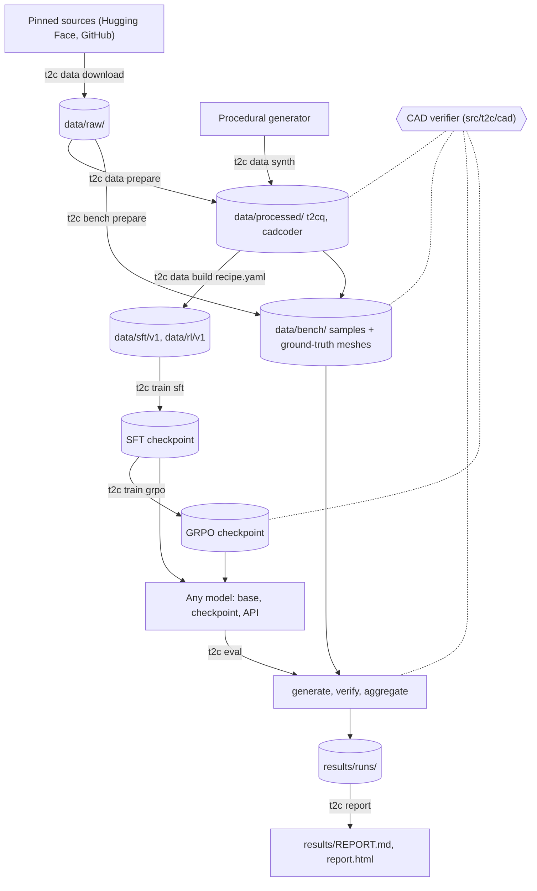

# Pipeline

The repository is one loop: **data → training → evaluation → report**, with a single
piece of code — the CAD verifier — in the middle of all of it.



## Stage by stage

| # | Stage | Command | Code | Writes | Read more |
|---|---|---|---|---|---|
| 1 | Download raw data at pinned revisions | `t2c data download` | [[data.sources]] | `data/raw/<source>/` | [[Data overview]] |
| 2 | Clean every training script and keep only the ones that build a valid solid | `t2c data prepare` | [[data.prepare]] | `data/processed/{t2cq,cadcoder}/` | [[Text-to-CadQuery dataset]], [[CAD-Coder dataset]] |
| 3 | Generate millimetre-scale parts with exact ground truth | `t2c data synth` | [[data.synth]] | `data/processed/synth/` | [[Synthetic parts]] |
| 4 | Turn the benchmarks into samples + ground-truth meshes | `t2c bench prepare` | [[bench.suites]] | `data/bench/<name>/` | [[Benchmarks overview]] |
| 5 | Assemble a training set from a recipe | `t2c data build configs/data/*.yaml` | [[data.build]] | `data/sft/…`, `data/rl/…` | [[Dataset recipes]] |
| 6 | Stage 1: supervised fine-tuning | `t2c train sft configs/sft/*.yaml` | [[train.sft]] | `outputs/train/<run>/` | [[Supervised fine-tuning]] |
| 7 | Stage 2: GRPO with the verifier as reward | `t2c train grpo configs/grpo/*.yaml` | [[train.grpo]] | `outputs/train/<run>/` | [[GRPO]], [[Walkthrough - one GRPO step]] |
| 8 | Evaluate any model on the benchmarks | `t2c eval --model …` | [[evalrun.run]], [[infer.backends]] | `results/runs/<run>/` | [[Walkthrough - scoring one answer]] |
| 9 | Rebuild the report | `t2c report` (also automatic after `t2c eval`) | [[results.report]] | `results/REPORT.md`, `results/report.html` | [[Reading the report]] |

Steps 1–5 are done once per cluster (≈ 30 min with many CPU cores). Steps 6–9 are the
experiment loop. During training, [[train.callbacks]] also scores a small benchmark subset
every N steps, so you see benchmark curves next to the loss.

All commands run interactively or as Slurm jobs through `scripts/submit.sh` — see
[[Scripts and clusters]].

## The verifier is the heart of the repository

The same code (`src/t2c/cad/`) answers "does this script build the right part?" in six
places. Because it is one implementation, a metric means the same thing everywhere.

| Where | What it checks | Settings |
|---|---|---|
| [[data.prepare]] | each training script builds one valid, watertight solid | no ground truth, 30 s timeout |
| [[data.synth]] | each generated part builds the solid the generator intended | bbox + volume vs closed form |
| [[bench.suites]] | benchmark ground truth is executable / loadable | — |
| [[evalrun.run]] | model answers vs ground truth (the benchmark numbers) | 256³ voxels, 30k points, 60 s |
| [[train.grpo]] | model answers vs ground truth (the RL reward) | 64³ voxels, 4k points, 20 s |
| [[train.callbacks]] | in-training benchmark subset | same as evaluation |

The verifier has three parts: [[cad.sandbox]] (run untrusted code safely and fast),
[[cad.metrics]] / [[cad.geometry]] (compare shapes), [[cad.reward]] (turn a comparison
into one number for RL). See [[Walkthrough - scoring one answer]] for the call sequence.

## What lives where on disk

```
data/                  # never committed; rebuilt from pinned sources (T2C_DATA_DIR)
  raw/<source>/        # untouched downloads + .t2c_source.json (revision, hashes)
  processed/<source>/  # verified corpora: {train,val,test}.jsonl + stats.json
  bench/<name>/        # samples.jsonl, gt/*.npz meshes, info.json
  sft/<recipe>/        # built SFT sets: train.jsonl, val.jsonl, info.json
  rl/<recipe>/         # built RL sets: train.jsonl + gt/*.npz
outputs/               # never committed (T2C_OUTPUT_DIR)
  train/<run>/         # checkpoints, final/, t2c_meta.json, tb/ logs, reward_log.jsonl, bench_log.jsonl
  slurm/               # job logs
results/               # T2C_RESULTS_DIR
  runs/<run-id>/       # summary.json (committed) + samples.jsonl.gz (local)
  REPORT.md, report.html
```

The three roots can be moved with environment variables — see [[paths]] and the cluster
profiles in [[Scripts and clusters]].
