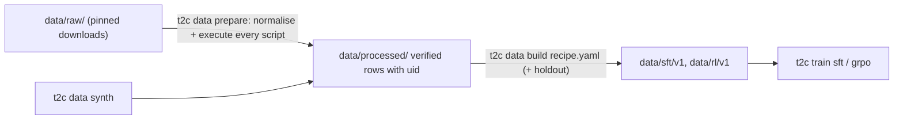

# Data overview

Five upstream sources plus one generator. Two sources (and the generator) are **training
data**; three are **benchmarks only** and must never be trained on.

| Source | Role | What it is | Size used | Licence | Note |
|---|---|---|---|---|---|
| `t2cq` | train | Text2CAD descriptions + CadQuery scripts written by Gemini 2.0 Flash | 98 473 train / 5 473 val / 5 472 test (verified) | unspecified; derived from Text2CAD (CC BY-NC-SA 4.0) | [[Text-to-CadQuery dataset]] |
| `cadcoder` | train | expert-level Text2CAD descriptions + CadQuery | 8 116 high-quality, 57 460 medium, 8 635 val | Apache-2.0 | [[CAD-Coder dataset]] |
| `synth` | train + benchmark | our procedural millimetre-scale parts | 20 000 / 500 / 400 parts, ×2 prompts | — (ours) | [[Synthetic parts]] |
| `t2cb` | benchmark | Text2CAD-Bench public prompt sample | 302 prompts, no ground truth | CC BY 4.0 | [[Text2CAD-Bench]] |
| `cqe` | benchmark | CadQueryEval tasks + reference parts + leaderboard | 25 tasks | MIT code; "never train" canary | [[CadQueryEval]] |
| `cadprompt` | benchmark | human prompts over DeepCAD objects | 200 objects × 2 prompts | unspecified (paper artifact) | [[CADPrompt]] |

The two training corpora (and two benchmarks) all descend from the same original data:
[[DeepCAD and Text2CAD]].

## From download to training set

1. [[data.sources]] downloads exact revisions.
2. [[data.prepare]] keeps only pairs whose script builds a valid, closed solid (≈ 99 %
   of `t2cq` survive; `cadcoder` loses mostly duplicates).
3. [[data.synth]] generates the millimetre-scale parts.
4. [[data.build]] mixes them according to a recipe and removes benchmark objects —
   [[Dataset recipes]].

## What you are training on (current recipes)
| Training set | Contents | Rows |
|---|---|---|
| `sft/v1` (SFT) | 98 379 `t2cq` + 7 569 `cadcoder` high + 40 000 `synth` (20 000 parts × geo/seq) | 145 948 train, 600 val |
| `rl/v1` (GRPO) | 3 000 `synth` + 2 000 `t2cq` + 1 000 `cadcoder` prompts, each with a ground-truth mesh | 6 000 |

So roughly **70 % of SFT examples are DeepCAD-style** (normalised units, machine-written
descriptions) and **30 % millimetre-scale synthetic parts**. That balance is one of the
main experimental knobs — compare with `sft/deepcad` (no synthetic data).

## The distribution problem in one picture
| | Training corpora (`t2cq`, `cadcoder`) | Target benchmarks (Text2CAD-Bench, CadQueryEval) |
|---|---|---|
| units | normalised (parts ≈ 0–1 "units") | millimetres |
| operations | sketch + extrude only | holes, fillets, chamfers, revolve, loft, sweep, shell, patterns |
| text | long, machine-generated, often coordinate lists | written by engineers: shape description or modelling steps |

Models trained only on DeepCAD-derived data score near zero IoU on Text2CAD-Bench in the
paper. The [[Synthetic parts]] exist to close this gap.

## Licences — matters if you publish a model
The DeepCAD-derived corpora inherit Text2CAD's non-commercial licence. CadQueryEval
carries a canary string and asks never to be trained on; [[Benchmark contamination]].

## On disk
`data/raw/<source>/` → `data/processed/<source>/{split}.jsonl` + `stats.json` →
`data/<kind>/<name>/` (+ `info.json`). Benchmarks: `data/bench/<name>/`. Total ≈ 1.2 GB.
