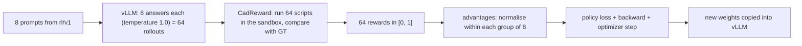

# Walkthrough — one GRPO step

What happens during one optimiser step of `t2c train grpo configs/grpo/qwen3-1.7b.yaml`.
Read [[GRPO]] first for the idea; this note maps it onto the code. Numbers are from that
config.

## Before the first step
[[train.grpo]] `main()`:

1. loads the config ([[train.common]]); `init_from: train/sft-qwen3-1.7b-v1/final` →
   start from the SFT checkpoint, and reuse its `chat_template_kwargs`.
2. starts the `CadExecutor` (CAD workers) **before** importing torch/vLLM ([[cad.sandbox]]).
3. reads the RL dataset `data/rl/v1/train.jsonl` ([[Dataset recipes]]): each row becomes
   `{"prompt": [system, user messages], "gt": "<path to ground-truth mesh>"}`.
4. loads the model with fp32 weights ([[Mixed precision]]), builds `GRPOConfig` from the
   `grpo:` block and `GRPOTrainer` with our reward function `CadReward` and the benchmark
   callback ([[train.callbacks]]).
5. TRL starts a vLLM engine *inside the same process, on the same GPU* (`vllm_mode:
   colocate`, 25 % of GPU memory) to generate rollouts fast ([[vLLM]]).

## One step

1. **Pick prompts.** `per_device_train_batch_size: 64` completions with `num_generations: 8`
   → 8 different prompts per step.
2. **Sample a group per prompt.** vLLM generates 8 answers for each prompt at
   `temperature: 1.0` (diversity is the point: we need some answers better than others),
   up to `max_completion_length: 1024` tokens. 64 rollouts.
3. **Score them.** TRL calls `CadReward(prompts, completions, gt=[...])` ([[train.grpo]]):
   - `extract_code` on each answer ([[cad.codeutil]]);
   - 64 jobs to the executor with cheaper training settings: 64³ voxels, 4 000 points,
     20 s timeout ([[cad.reward]]);
   - `reward_from_result` turns each result into a number:

     | outcome | reward |
     |---|---|
     | no code / syntax error / refused | 0.0 |
     | parses but raises, times out or crashes | 0.1 |
     | runs but no solid in `result` | 0.2 |
     | valid solid | 0.3 + 0.5·IoU + 0.1·(1 − CD/0.3) + 0.1·exp(−dim_err/0.25) |

   - minus 0.05 if the answer has more than 20 characters of prose outside the code block.
   - extra statistics (`cad/valid_rate`, `cad/iou_all`, error shares, verification time) go
     to the trainer's log and to `outputs/train/<run>/reward_log.jsonl`.
4. **Advantages.** Inside TRL: for each group of 8, advantage = (reward − group mean) /
   group std (`scale_rewards: group`, the default). If all 8 answers got the same reward,
   all advantages are 0 and that prompt teaches nothing — the reason for the reward
   *ladder* in step 3.
5. **Loss and update.** TRL's default loss (`loss_type: dapo`) pushes up the probability of
   tokens in above-average answers and down in below-average ones, with PPO-style clipping
   (`epsilon: 0.2`). `beta: 0.0` → no KL penalty, so no frozen reference model in memory.
   Backward in bf16 autocast, gradient clipping at 0.5, AdamW step at lr 2e-6.
   `mask_truncated_completions: true` ignores answers cut at the token limit.
6. **Sync.** At the next generation, TRL copies the updated weights into the vLLM engine.

Time per step with Qwen3-0.6B on one H200: about 6 s (the pilot run did 100 steps in ~10
minutes), of which CAD verification of the 64 scripts is well under a second.

## Every N steps
- `logging_steps: 5` → loss, reward mean/std, completion lengths, `cad/*` to TensorBoard.
- `save_steps: 50` → `checkpoint-N/` (keeps the last 10).
- `eval_during_training.every_steps: 100` → [[train.callbacks]] makes the model answer 48
  CadQueryEval and 48 DeepCAD tasks greedily and logs `eval/cqe_pass_rate`,
  `eval/deepcad_iou_all`, … plus `bench_log.jsonl`.

## What to watch in TensorBoard
- `reward` going up and `cad/valid_rate` going up: the policy is learning what the reward measures.
- `frac_reward_zero_std`: share of groups where all 8 answers scored the same — high means
  little learning signal.
- `completions/mean_length` and `clipped_ratio`: answers growing towards the limit is a
  common failure mode.
- `eval/*` from the callback: does the reward improvement transfer to the benchmarks?
  (In the pilot run it did for DeepCAD, not for CadQueryEval — see [[Benchmarks overview]].)
