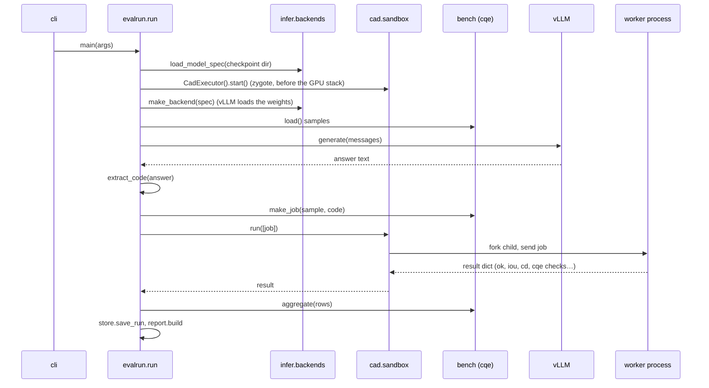

# Walkthrough — scoring one answer

Follow one benchmark task from the command line to a number in the report. This is the
best way into the code: it passes through almost every module.

**Example.** You run

```bash
t2c eval --model outputs/train/sft-qwen3-1.7b-v1/final --bench cqe
```

and we follow CadQueryEval `task1`: *"A simple hex nut without the threads modeled…
10 mm wide (flat side to flat side)… hole diameter 5 mm… thickness 5 mm."*



## 1. Command line → evaluation loop
`t2c` is the console script declared in `pyproject.toml`; [[cli]] parses the arguments and
calls `evalrun.run.main(args)` ([[evalrun.run]]).

## 2. Which model, and how to talk to it
`load_model_spec(path)` ([[infer.backends]]) sees a directory, finds `t2c_meta.json` (written
by the trainer one level up, see [[train.common]]) and builds a `ModelSpec`:

- `prompt_style = native` — fine-tuned models get the short system prompt they were
  trained with ([[prompts]]). A base model from `configs/models/*.yaml` would get the
  benchmark's own published prompt (`protocol`).
- `chat_template_kwargs = {enable_thinking: false}` — copied from training, so the prompt
  is rendered exactly as during training ([[Tokenizers and chat templates]]).
- lineage: `stage = sft`, `base_model = Qwen/Qwen3-1.7B`, `train_run`, `step`.

## 3. Start the CAD workers first, then the GPU model
`CadExecutor(...).start()` ([[cad.sandbox]]) launches the **zygote**: a small Python
process that imports cadquery once and will fork one child per script. It is started
*before* vLLM/torch so that the forked children are small and clean. Then
`make_backend(spec)` creates a `VLLMBackend`, which loads the weights on the GPU ([[vLLM]]).

## 4. Build the conversation
`bench.load()` reads `data/bench/cqe/samples.jsonl` ([[bench.base]]). For `task1` the
user message is the task text (description + target bounding box + expected components,
formatted by [[bench.suites]]). `prompts.build_messages(task, system)` makes

```
[{"role": "system", "content": NATIVE_SYSTEM}, {"role": "user", "content": "## Task Description\nA simple hex nut…"}]
```

## 5. Generate
`VLLMBackend.generate` renders each conversation with `render_prompt` (the tokenizer's chat
template), tokenises it and hands **token ids** to vLLM, greedy decoding (`temperature 0`,
see [[Decoding]]). All 25 tasks go in one batch. The answer is text such as

````
```python
import cadquery as cq
result = cq.Workplane("XY").polygon(6, 11.547).extrude(5).faces(">Z").workplane().hole(5)
```
````

## 6. Extract the code
`extract_code(answer)` ([[cad.codeutil]]) removes any `<think>…</think>` block and takes
the last fenced Python block that mentions cadquery (or the raw text if it already is a
script). No code → the sample is invalid with `error_type = no_code`.

## 7. Turn it into a verifier job
`CadQueryEval.make_job(sample, code, style)` ([[bench.suites]]) returns a plain dict:

| key | value here | meaning |
|---|---|---|
| `code` | the script | what to run |
| `timeout` | 60 | seconds before the process is killed |
| `gt` | `data/bench/cqe/gt/task1.npz` | ground-truth mesh for IoU / Chamfer |
| `res`, `n_points` | 256, 30 000 | voxel grid size and surface samples ([[Metrics]]) |
| `cqe` | reference meshes + expected component count | for the six CadQueryEval checks |
| `tess` | `{abs: 0.1, ang: 0.1}` | mesh resolution matching what an STL export would use |

(With the `protocol` prompt the job instead says `output_stl: "output.stl"`: the official
contract is that the script writes the STL itself.)

## 8. Run it safely
`CadExecutor.run([job])` ([[cad.sandbox]]):

1. **static check** with Python's `ast`: refuses `import subprocess`, `os.remove`, `eval`… →
   `unsafe_code` without running anything.
2. sends the job to the zygote, which creates a scratch directory and **forks** a child.
3. the child (`worker.child_entry`) sets limits (memory, CPU time, file size), detaches
   from the terminal, and calls `worker.run_job`.

## 9. Inside the worker: execute, mesh, score
`run_job` ([[cad.sandbox]]):

1. `exec` the script → must define `result` (stage 1 if it raises, stage 2 if `result` is
   missing or holds no solid).
2. collect the solid(s) from `result`, check volume > 0, **tessellate** into triangles
   (`v`, `f` arrays) — [[CadQuery and B-rep]].
3. `protocol_metrics(pred, gt)` ([[cad.metrics]]): normalise both meshes to a unit
   bounding box, voxelise at 256³ and compute **IoU**, sample 30 000 surface points and
   compute **Chamfer distance**, plus **dim_err** on the real sizes.
4. `cqe_best(...)` ([[cad.metrics]]): rigidly align the part to the reference ([[Rigid alignment]])
   and run the six CadQueryEval checks (watertight, one component, bounding box ±1 mm,
   volume ±2 %, Chamfer ≤ 1 mm, Hausdorff-95 ≤ 1 mm).
5. send back a dict: `ok`, `stage`, `error_type`, `iou`, `cd`, `dim_err`, `volume`, `bbox`,
   `cqe: {passed, …}`.

If the script segfaults the CAD kernel or runs past 60 s, only this child dies; the zygote
reports `crash` or `timeout`.

## 10. Retries (only where the protocol allows them)
For Text2CAD-Bench (3 retries) a failed sample gets a second conversation: the old answer
plus a user turn *"The previous CadQuery code attempt failed with an error … ## Error
Message: …"* ([[prompts]]), and steps 5–9 run again. CadQueryEval allows none.

## 11. One row per sample, then the aggregate
[[evalrun.run]] writes a row (`valid`, `first_valid`, `error_type`, `iou`, `cd`, the code,
the raw answer, `cqe_passed`…). `bench.aggregate(rows)` ([[bench.base]]) computes **IR**,
**IR@1**, **IoU**, **IoU_all**, **CD**, and for CadQueryEval the **pass rate** and each
check's rate — overall and per group.

## 12. Store and report
[[results.store]] saves `results/runs/<timestamp>-cqe-<model>/summary.json` (+ the rows,
gzipped). [[results.report]] rebuilds `results/REPORT.md` and `report.html`, where the row
appears next to the base model (with the difference) and next to the published
leaderboard. See [[Reading the report]].
