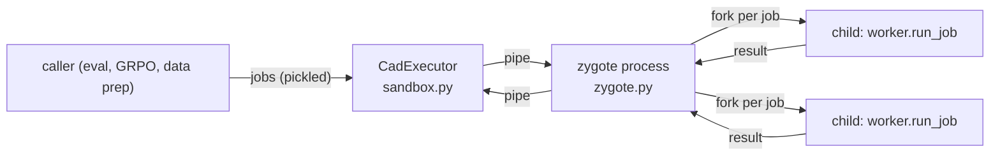

# cad.sandbox
**Files:** `src/t2c/cad/sandbox.py`, `src/t2c/cad/zygote.py`, `src/t2c/cad/worker.py`
**Libraries:** [[Libraries#cadquery|cadquery]] (in the worker), [[Libraries#trimesh|trimesh]], [[Libraries#tqdm|tqdm]], standard library (`subprocess`, `os.fork`, `selectors`, `resource`, `ctypes`, `pickle`)
**Concepts:** [[Sandboxing untrusted code]] · [[CadQuery and B-rep]]

The engine that runs model-written CadQuery scripts: hundreds of thousands of them, in
parallel, without letting a crash, an infinite loop or a stray `os.remove` hurt the
caller. Every other part of the project that touches geometry goes through it.

## Why it is built this way
- **The CAD kernel can segfault.** OpenCascade is C++; a bad fillet can kill the whole
  Python process. So every script runs in its *own* process.
- **Importing cadquery takes ~2 s.** Starting a fresh Python per script would be slow. So
  a **zygote** process imports everything once and *forks* a copy per script (fork copies
  the already-loaded memory; a child is ready in ~10 ms).
- **Model code is untrusted.** It might loop forever, allocate 40 GB, write files or open
  network connections. Hence time / memory limits, a private scratch directory, no network,
  and a static check before anything runs.

## The three files

### `sandbox.py` — `CadExecutor` (runs in the caller)
- `CadExecutor(workers=None, timeout=60, mem_gb=None)`; `workers` defaults to the
  allocated CPU cores − 1 (or `T2C_CAD_WORKERS`), memory limit 16 GB per script (or
  `T2C_SANDBOX_MEM_GB`).
- `start()` launches `python -m t2c.cad.zygote` as a subprocess connected by two pipes and
  sends a *probe* job: it fails loudly if cadquery cannot be imported, and records whether
  network isolation worked (`executor.info`, printed by `t2c doctor`).
- `run(jobs, progress=None)` → list of result dicts **in the same order**. Jobs with no code
  or rejected by the static check ([[cad.codeutil]]) are answered immediately without a
  process. The rest are streamed to the zygote, at most `workers` at a time.
- Messages are length-prefixed pickles. A background thread reads results so that the
  two pipes can never deadlock.

### `zygote.py` — the forking server (its own process)
1. Enters an **empty network namespace** using an unprivileged user namespace (Linux
   `unshare`, called through `ctypes`). Every child inherits it: `socket.connect` fails with
   "Network is unreachable". Skipped with `T2C_SANDBOX_NET=0` or if the kernel forbids it.
2. Imports cadquery, scipy, trimesh and `t2c.cad.worker` once.
3. Loop: read a job → make a scratch directory → `fork()` → the child runs
   `worker.child_entry`. Watch all children with `selectors`; on the deadline kill the
   child's whole process group (`SIGKILL`) and answer `timeout`; if a child dies from a
   signal answer `crash` (e.g. `SIGSEGV`); delete the scratch directory.
4. If the caller disappears (pipe closed), kill every child and exit — nothing is left behind.

### `worker.py` — what a child does
`child_entry` (set-up): new session/process group, limits with `resource.setrlimit` (no
core dumps; files ≤ 512 MB; CPU time ≈ timeout + 10 s; address space = memory limit),
`chdir` into the scratch directory, silence stdout/stderr.

`run_job(job)` (the work):
1. `execute_script` — `compile` + `exec` the code with the file name `generated.py`, so
   error messages show only the script's own lines (useful feedback for retries).
2. `shape_from_namespace` — read `result` (a `Workplane`, `Shape`, `Assembly` or list) and
   collect its solids.
3. Volume check, then **tessellate** the B-rep into triangles (`v`, `f` numpy arrays;
   tolerance 5·10⁻⁴ of the part size, 0.2 rad angular).
4. Optional extras, depending on the job (see table): save the mesh, check it is closed,
   compare with ground truth ([[cad.metrics]]), run the CadQueryEval checks.
5. Return a result dict. **It never raises**: every failure is classified.

## Job dictionary (input)
| Key | Meaning | Who sets it |
|---|---|---|
| `code` | the script | everyone |
| `timeout` | seconds (default 60) | benchmarks, reward (20) |
| `gt` | path of a ground-truth mesh `.npz` → IoU / CD / dim_err | benchmarks, reward |
| `res`, `n_points` | voxel resolution, surface points for the metrics | benchmarks (256, 30 000), reward (64, 4 000) |
| `save_mesh` | write the produced mesh to this `.npz` | ground-truth creation |
| `self_check` | voxel resolution for a watertightness check (`open_frac`) | data preparation, generator |
| `tess` | tessellation tolerance override | CadQueryEval |
| `output_stl` | read the mesh from a file the script wrote (CadQueryEval protocol) | CadQueryEval |
| `cqe` | reference meshes + expected components → six checks | CadQueryEval |

## Result dictionary (output)
`ok`, `stage`, `error_type`, `error` (message, with the failing line), then for valid
solids `volume`, `bbox` (extents x, y, z), `n_solids`, `n_tris`, `brep_valid`, and
depending on the job `iou`, `cd`, `dim_err`, `open_frac`, `cqe{…}`, timings.

**Stages** (used by the reward ladder, [[cad.reward]]):

| stage | meaning | `error_type` values |
|---|---|---|
| 0 | nothing runnable | `no_code`, `syntax_error`, `unsafe_code` |
| 1 | parsed but failed while running | `runtime_error`, `timeout`, `crash`, `memory` |
| 2 | ran, but no usable solid | `no_result`, `bad_result_type`, `no_solid`, `degenerate`, `no_output_file` |
| 3 | valid solid | — (`ok = true`) |

`harness_error` means *our* code failed (e.g. a corrupt ground-truth file). It keeps the
stage and is excluded from metrics ([[bench.base]]).

## Performance
Start-up ≈ 2.5 s. Simple parts: ≈ 200 scripts/s on 8 cores. Real corpus scripts: ≈ 130/s
on 96 cores (the 185 000 training scripts took ≈ 25 min). The benchmark metrics (256³
voxels) cost ≈ 0.5 s per part; the training-time settings ≈ 0.1 s.

## Limits (by design)
It protects against accidents, not against an adversary: a script can still read files
and write anywhere your user can. Do not feed it untrusted third-party code.

**Used by:** [[evalrun.run]], [[train.grpo]], [[train.callbacks]], [[data.prepare]],
[[data.synth]], [[data.build]], [[bench.suites]], [[bench.cqe]], [[cli]] (`doctor`).
**Tested in:** [[test_sandbox]], and indirectly by every other test file.
