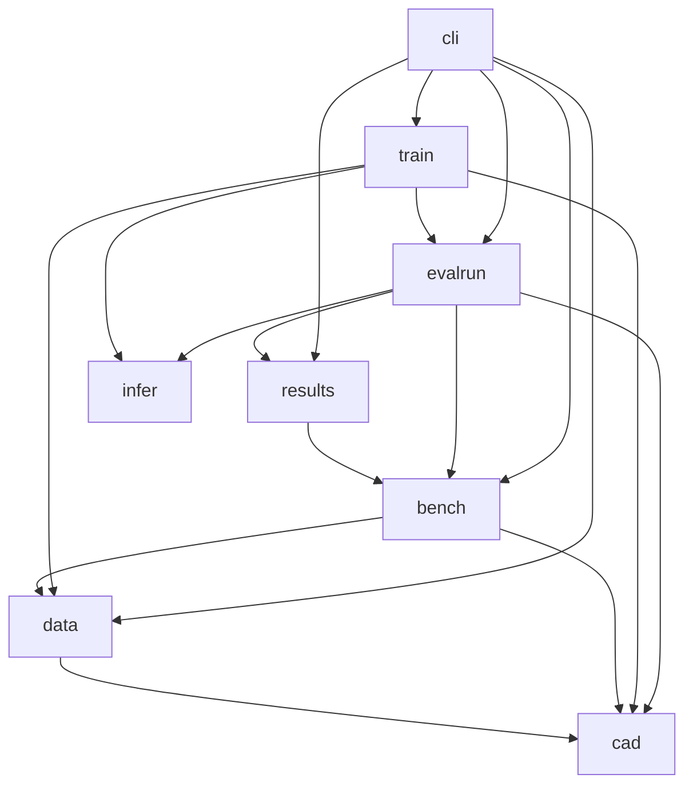

# t2c package

All code lives in `src/t2c/` (about 5 800 lines). It is an installable package: after
`scripts/bootstrap.sh`, `import t2c` works and the `t2c` command calls `t2c.cli:main`.

Arrows mean "imports". `cad` (the verifier) imports nothing else from the package: it is
the foundation everything else builds on.

## Top-level modules
| Module | File | Role |
|---|---|---|
| [[cli]] | `cli.py` | the `t2c` command: parses arguments, calls the right function |
| [[paths]] | `paths.py` | where data, outputs and results live (overridable by environment variables) |
| [[prompts]] | `prompts.py` | system prompts, retry message, the "training target" format |

## cad
The verifier: run a CadQuery script safely and compare the solid with ground truth.
| Module | File(s) | Role |
|---|---|---|
| [[cad.sandbox]] | `sandbox.py`, `zygote.py`, `worker.py` | sandboxed, parallel execution of scripts; meshing; calls the metrics |
| [[cad.codeutil]] | `codeutil.py` | pull code out of a model answer; static safety check; normalise reference scripts |
| [[cad.geometry]] | `geometry.py` | mesh utilities: normalise, sample points, voxelise, volume |
| [[cad.metrics]] | `metrics.py` | IoU, Chamfer, dimension error; rigid alignment; CadQueryEval checks |
| [[cad.reward]] | `reward.py` | turns a verifier result into one number for RL |

## data
| Module | File | Role |
|---|---|---|
| [[data.sources]] | `sources.py` | pinned download of the five upstream sources |
| [[data.prepare]] | `prepare.py` | clean and execution-verify the training corpora |
| [[data.synth]] | `synth.py` | procedural generator of millimetre-scale parts |
| [[data.build]] | `build.py` | assemble SFT / RL datasets from recipes, with leakage control |

## bench
| Module | File | Role |
|---|---|---|
| [[bench.base]] | `base.py`, `registry.py` | the `Benchmark` interface, core metrics, the list of benchmarks |
| [[bench.suites]] | `suites.py` | the five benchmarks: how each is prepared and scored |
| [[bench.cqe]] | `cqe.py` | checks our CadQueryEval scorer against the official verdicts |

## infer, evalrun, results
| Module | File | Role |
|---|---|---|
| [[infer.backends]] | `infer/backends.py` | model specs; vLLM / transformers / API backends |
| [[evalrun.run]] | `evalrun/run.py` | the evaluation loop (generate → verify → retry → aggregate → store) |
| [[results.store]] | `results/store.py` | one directory per evaluation run |
| [[results.report]] | `results/report.py` | builds `REPORT.md` and `report.html` |

## train
| Module | File | Role |
|---|---|---|
| [[train.common]] | `common.py` | configs, run directories, where to start from, `t2c_meta.json` |
| [[train.sft]] | `sft.py` | stage 1, supervised fine-tuning |
| [[train.grpo]] | `grpo.py` | stage 2, GRPO with the CAD reward |
| [[train.callbacks]] | `callbacks.py` | benchmark subset scored during training |

## Conventions used everywhere
- **Heavy imports are lazy.** torch, vLLM and cadquery are imported inside functions, so
  `t2c --help`, `t2c runs` or `t2c report` start instantly and work without a GPU.
- **CAD workers start before the GPU stack.** Every entry point that needs both creates
  the `CadExecutor` first, so the worker processes are forked from a small, clean process.
- **Everything is a plain file.** JSONL for data and results, `.npz` for meshes, YAML for
  configs: you can inspect anything with `head`, `jq` or Python.
- **Seeded and pinned.** Downloads use exact revisions; every random choice has a seed.
